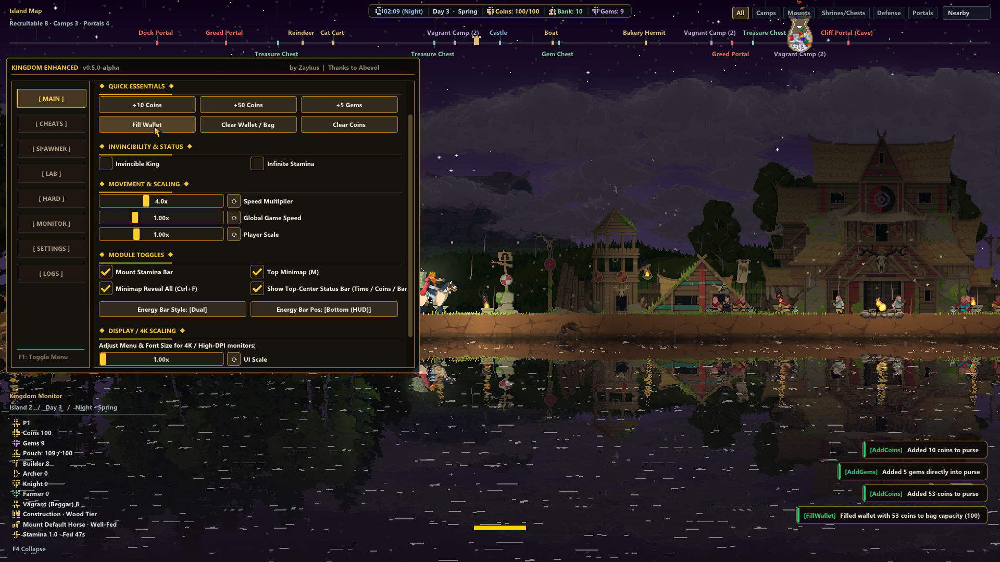

<div align="center">

# Kingdom Enhanced

[](https://github.com/Zaykus/KingdomEnhanced/releases)
[-blue.svg)](#)
[](#)
[](#legal-disclaimer--eula-compliance)

**Kingdom Enhanced** is a high-performance native C++ enhancement modification and quality-of-life suite for **Kingdom Two Crowns** (IL2CPP 64-bit, DirectX 11 & DirectX 12). 

Created by **Zaykus** as the official standalone continuation and complete native rewrite of the original Kingdom Enhanced project (also known as KTC-mod), engineered from the ground up to restore, stabilize, and dramatically expand the game's modding capabilities with zero external mod loader dependencies.

<br/>



</div>

---

<div align="center">

## What's New & Ported in v0.5.0-alpha

</div>

This project revitalizes the legacy mod into a standalone, crash-free, zero-dependency suite:

- **100% Native C++ Architecture**: Unlike legacy mods requiring external C# Mono injectors or BepInEx loaders that cause freezes, Kingdom Enhanced runs via a native `version.dll` proxy hooked directly into the game's DirectX 11/12 swapchain and IL2CPP runtime.
- **Knight Squad Tactical Transfer**: Instantly rally knight squads and their archer escorts to march across the settlement to reinforce the active West or East frontier wall.
- **Royal Banking & Treasury System**: In-menu deposit and withdrawal vault controls, automated bank sweepers for ground coins with payment protection, and auto-bank overflow redirect.
- **Complete & Launch Boat Automation**: Complete repair of unbuilt shipwrecks, purchasing and stacking of parts, hull mounting, and direct dock launch.
- **Smart Edge-Wall Forest Clearing**: Outermost edge-wall perimeter tree felling with directional West/East feedback and strict 18m sanctuary protection around camps and merchant huts.
- **Symmetrical Panoramic Top Minimap (F2)**: Dual-wing projection anchoring the Castle/Campfire dead-center at 50% screen width, with interactive right-click context menus, quick filter pills, and zoom mode.
- **Biome & Weapon Protections**: Strict DLC restrictions (Pikes in Medieval/Olympus, Katanas in Shogun), unemployed citizen requirements, standalone fire arrows toggle, and independent Archer/Tower fire rate sliders.
- **Divine Relics & Handsocket Artifacts**: Equip and activate Norse Lands and Call of Olympus mythical relics (Thor's Hammer, Hel's Scythe, Heimdall's Horn, Artemis Bow, etc.) with functional handsocket attachments.
- **Island Travel Continuity**: Big wallet capacity presets and custom mount speed multipliers persist across island travel on the same campaign without save crashes.
- **Kingdom Monitor HUD (F4)**: Real-time population demographics, wealth, and mount stamina telemetry with customizable styles.
- **6-Language Native Font Localization**: Full Latin, CJK, and Korean typography for English, Chinese, Korean, Spanish, German, and French.
- **Live In-Menu Action Logger**: Real-time diagnostic terminal inside the mod menu (`F1 -> Logs`) and file logging (`KingdomEnhanced.log`) providing instant feedback on every user action.

---

<div align="center">

## Features

</div>

### 1. Monarch, Economy & Royal Banking
- **God Mode & Infinite Stamina**: Complete invulnerability for your monarch against all Greed attacks, plus unlimited sprint for any mount without tiring or eating grass.
- **Speed Multipliers & Resizer**: Adjustable monarch move speed (1.0x to 5.0x) and dynamic visual scale adjustments.
- **Expanded Royal Purse**: Configurable big bag capacity presets (100, 250, 500, or 1000 coins) that persist cleanly across islands.
- **Royal Banker Vault Controls**: Deposit +10 and Withdraw -10 coins directly to/from the Banker without manual coin dropping.
- **Smart Ground Coin Sweeper**: Automatically collects coins dropped from hunting, farming, and water spills into the bank vault with payment animation immunity.
- **Auto-Bank Overflow**: Automatically sweeps excess coins into the vault when the purse is full to prevent water loss.

### 2. Military, Combat & Tactical Defense
- **Knight Squad Tactical Transfer**: Rally and transfer Knight squads to the Left or Right frontier wall with coordinated unit march logic.
- **Drop Tools Suite**: Spawn worker hammers, archer bows, pikes, katanas, and Norse round shields anywhere on the map with biome availability checks and idle peasant validation.
- **Norse Lands Round Shields**: Equips all citizen types (Archers, Builders, Farmers, Peasants) to form defensive shieldwalls effortlessly.
- **Standalone Flaming Arrows**: Toggles fire arrow upgrades on archers without altering attack speed.
- **Independent Fire Rate Sliders**: Fine-tune Ground Archer fire rate and Watchtower fire rate independently (1.0x to 5.0x).
- **Divine Artifacts & Relics**: Equip and fire legendary mythical weapons (Thor's Hammer, Hel's Scythe, Heimdall's Horn, Artemis Bow) with functional handsocket attachments.
- **Combat Utilities**: Instant Kill All Enemies, Destroy Portals, and Catapult boulder launch (`Spacebar`) factoring monarch facing direction.

### 3. Unit, Mount & Greed Spawner
- **Civilian & Combatant Spawner**: Spawn Peasants/Villagers, Vagrants/Beggars, Archers, Builders/Workers, Farmers, Pikemen, Knights, Berserkers, and Ninjas.
- **Mount & Hermit Spawner**: Spawn all 27+ mounts across all DLCs with duplicate prevention, plus Hermits and wildlife.
- **Greed Wave Spawner**: Spawn Greedlings, Masked Greed, Breeders, Crown Stealers, Floaters, Crushers, Greed Knights, and Greed Archers.
- **Unified Target Coordinates**: Select whether spawned units appear near the Monarch, at the Castle Center, at the Left Wall, or at the Right Wall.

### 4. Kingdom Maintenance & World Lab
- **Instant Wall Repair**: Restore all defensive fortifications across the island to 100% HP with a single click.
- **Complete & Launch Boat**: Automatically repairs unbuilt shipwrecks, purchases missing parts, stacks materials, mounts hull pieces, and pushes the vessel directly to the dock.
- **Smart Edge-Wall Forest Clearing**: Safely clears trees strictly outside outermost perimeter walls (West, East, or Both) while protecting vagrant camp and merchant sanctuaries (>18m clearance).
- **Weather & Season Controller**: Switch instantaneously between Spring, Summer, Autumn, or Winter, lock eternal summer, or set Clear, Rain, Fog, or Storm weather.
- **Time Controls**: Skip days, fast-forward to dawn or nightfall, and disable Blood Moons.

### 5. Symmetrical Panoramic Minimap (F2)
- **Dead-Center Castle Projection**: Symmetrical dual-wing coordinate system pins the Castle/Campfire at the exact 50% dead-center of the screen regardless of island terrain asymmetry.
- **Full Island Tracking**: Real-time positions of your Monarch, Castle, Walls, Portals, Vagrant Camps, Hermits, Steeds, and Greed waves.
- **Interactive POI Context Menu**: Right-click any minimap icon to Teleport Here, Recruit Vagrants, Destroy Portals, or Repair Walls.
- **Quick Filter Pills**: Toggle specific categories (All, Camps, Mounts, Shrines/Chests, Defense, Threats) with zero frame stutter.

### 6. Kingdom Monitor HUD (F4)
- **Real-Time Census**: Live demographic breakdown (Peasants, Archers, Builders, Knights, Squires, Pikemen, Ninjas, Farmers, Beggars).
- **Fortifications & Economy**: Fortified perimeter status, standing walls, portal counts, purse coins, vault coins, and gems.
- **Mount Telemetry**: Active steed name, mount feed status, and live stamina gauge.
- **Customizable Appearance**: Dynamic alpha transparency adjustment and customizable visual themes.

---

<div align="center">

## Default Controls & Hotkeys

</div>

| Hotkey | Action |
|---|---|
| **F1** or **Insert** | Toggle Main Enhancement Menu |
| **F2** | Toggle Symmetrical Panoramic Top Minimap |
| **F3** | Toggle Fast Forward Speed |
| **F4** | Toggle Kingdom Monitor HUD |
| **Spacebar** | Launch Catapult Boulder (in facing direction) |
| **C** | Drop Coins (Configurable burst amount) |
| **G** | Drop Gems (Configurable burst amount) |
| **F** | Trigger Equipped Special Weapon / Relic Ability |

*All hotkeys can be fully customized in-game via **Menu -> Settings** or directly in `KingdomEnhanced.ini`.*

---

<div align="center">

## Installation

</div>

1. Download the latest release archive (`KingdomEnhanced-v0.5.0-alpha.zip`).
2. Extract the archive contents:
   - `version.dll`
   - `KingdomEnhanced.ini` (optional default configuration)
3. Move `version.dll` and `KingdomEnhanced.ini` directly into your Kingdom Two Crowns game folder (the directory containing `KingdomTwoCrowns.exe`):
   - *Example Steam path*: `C:\Program Files (x86)\Steam\steamapps\common\Kingdom Two Crowns\`
4. Launch the game normally and press **F1** to open the menu.

### Uninstallation
Simply delete `version.dll` and `KingdomEnhanced.ini` from your game folder. The original game files remain completely untouched.

---

<div align="center">

## Configuration (`KingdomEnhanced.ini`)

</div>

The mod automatically generates and maintains `KingdomEnhanced.ini` in the game directory. Settings can be edited live via the **F1** in-game menu or manually with any text editor:

```ini
[General]
Language=English      ; English, Chinese, Korean, Spanish, German, French

[Modules]
EnableMinimap=1       ; Panoramic top radar map
EnableStaminaBar=1    ; Mount stamina gauge
EnableHotkeys=1       ; Boulder/teleport hotkeys
UIScale=1.00          ; 0.75x - 2.50x display scale
BoldFont=0            ; 1 = Bolder text font
MonitorAlpha=0.55     ; Translucency of F4 HUD

[Cheats]
GodMode=0
InfiniteStamina=1
SpeedMultiplier=2.00
```

---

<div align="center">

## Frequently Asked Questions (FAQ)

</div>

#### Q: Does this mod work with the latest Steam / GOG release of Kingdom Two Crowns?
**A:** Yes. The mod is built against the 64-bit Unity IL2CPP runtime with native DirectX 11 and DirectX 12 renderers.

#### Q: Do I need BepInEx, MelonLoader, or Mono?
**A:** No. Kingdom Enhanced is completely standalone. It operates via a native proxy DLL without requiring any third-party mod loader or external runtime framework.

#### Q: Will this cause lag or game stutter?
**A:** No. All rendering is synchronized to the native swapchain present pipeline, and engine interactions run asynchronously on Unity's main thread to prevent frame drops, lag, or stutter.

#### Q: Can I use this on all DLCs?
**A:** Yes. Fully compatible with Medieval (Classic), Shogun, Dead Lands, Norse Lands, and Call of Olympus.

---

<div align="center">

## Legal Disclaimer & EULA Compliance

</div>

> [!IMPORTANT]
> **Please read this disclaimer carefully before using this software.**

1. **Non-Commercial & Fan-Made**: This modification is an independent, non-commercial, open-source fan project developed strictly for educational, research, and single-player entertainment purposes.
2. **Intellectual Property**: **Kingdom Two Crowns**, its assets, artwork, audio, trademarks, and associated intellectual property are the exclusive property of **Raw Fury**, **Fury Studios**, and **Coatsink**. The creators of this modification claim no ownership over any original game assets or trademarks.
3. **No Redistribution of Proprietary Assets**: This software does NOT contain, package, or distribute any copyrighted game binaries, proprietary art, sound, or game code. It operates solely as a dynamic runtime memory interop module (`version.dll`) linking user-owned game files on the user's local machine.
4. **Offline & Single-Player Intended**: This modification is designed exclusively for offline and single-player gameplay. It is not intended to bypass software copy protection, DRM, or gain unfair advantage in competitive network environments.
5. **Fair Use & Reverse Engineering**: Code analysis and runtime hooks are implemented in compliance with jurisdictional fair-use provisions for software interoperability and user customization.
6. **No Warranty**: This software is provided *"as-is"*, without warranty of any kind, express or implied. Users assume all responsibility for the use of this software.

---

<div align="center">

## Credits & Acknowledgments

</div>

- **Zaykus** — Lead Developer  
  Architecture, Native C++ Suite, Accessibility systems, DirectX 12 Hook & UI everything lol
- **Abevol** — Framework & Engine Research  
  Engine analysis and IL2CPP reverse engineering groundwork + open source mod ([https://github.com/abevol](https://github.com/abevol))
- **Community Testers and special thanks to Zeternal-1**  
  Accessibility validation, testing, profiling, and community feedback
- **Dear ImGui** (Omar Cornut) — Immediate mode graphical user interface library
- **MinHook** (Tsuda Kageyu) — The Minimalistic x86/x64 API Hooking Library
